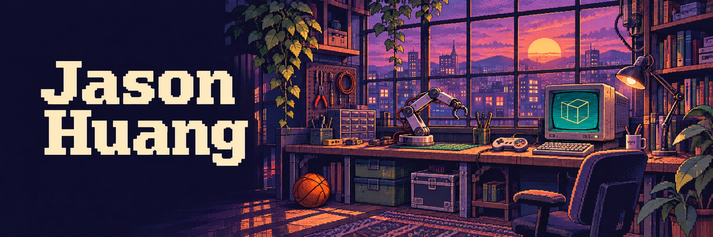

  

我叫 **Jason Huang**，学计算机，研究 **具身智能（Embodied AI）**。我感兴趣的是，机器人看到眼前的世界之后，怎样决定下一步该做什么。

### 我的兴趣卡带

点卡面直达球赛、游戏或赛事官网，点下方的名字展开卡带。

<table>
  <tr>
    <td width="33%" align="center" valign="top">
      
      

        
<b>篮球与 NBA</b>

        
场上打球，场下看 NBA。

        
<a href="https://www.nba.com/schedule">NBA 赛程</a>

      

    </td>
    <td width="33%" align="center" valign="top">
      
      

        
<b>沙盒游戏</b>

        
在《我的世界》搭方块，在《泰拉瑞亚》挖到地下。

        
<a href="https://www.minecraft.net/zh-hans">Minecraft</a> <a href="https://terraria.org/">Terraria</a>

      

    </td>
    <td width="33%" align="center" valign="top">
      
      

        
<b>电竞</b>

        
瓦罗兰特和 CS。

        
<a href="https://valorantesports.com/">VALORANT 赛事</a> <a href="https://www.hltv.org/matches">CS 比赛日程</a>

      

    </td>
  </tr>
</table>

### 教育经历

<table>
  <tr>
    <td width="50%" valign="top">
       
      <strong>新疆大学</strong> 
      本科 · 计算机科学与技术
    </td>
    <td width="50%" valign="top">
       
      <strong>华中科技大学</strong> 
      硕士 · 计算机技术
    </td>
  </tr>
</table>

### 贡献记录

  
展开 3D 贡献日历

  

  <a href="./assets/activity/calendar-light.svg">查看浅色日历</a>

