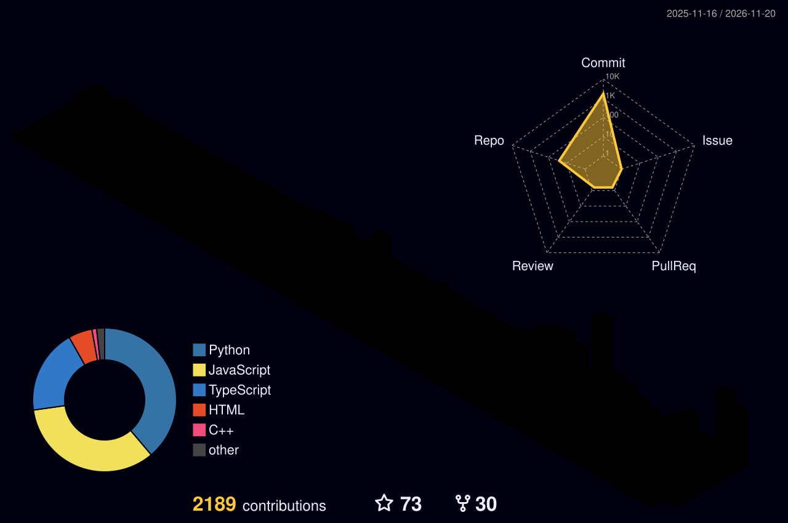

  

I'm **Jason Huang**. I study **embodied AI**, especially how robots use what they see to decide what to do next.

### My cartridges

Select a cover to visit its site. Open the label underneath to see what I play or watch.

<table>
  <tr>
    <td width="33%" align="center" valign="top">
      
      

        
<b>Hoops</b>

        
I play hoops and watch the NBA.

        
<a href="https://www.nba.com/schedule">NBA games</a>

      

    </td>
    <td width="33%" align="center" valign="top">
      
      

        
<b>Sandbox</b>

        
I build in Minecraft and dig for ore in Terraria.

        
<a href="https://www.minecraft.net/en-us">Minecraft</a> <a href="https://terraria.org/">Terraria</a>

      

    </td>
    <td width="33%" align="center" valign="top">
      
      

        
<b>Esports</b>

        
My games of choice are VALORANT and Counter-Strike.

        
<a href="https://valorantesports.com/en-US">VALORANT events</a> <a href="https://www.hltv.org/matches">CS matches</a>

      

    </td>
  </tr>
</table>

### Education

<table>
  <tr>
    <td width="50%" valign="top">
       
      <strong>Xinjiang University</strong> 
      Bachelor's in Computer Science and Technology
    </td>
    <td width="50%" valign="top">
       
      <strong>Huazhong University of Science and Technology</strong> 
      Master's in Computer Technology
    </td>
  </tr>
</table>

### Commit calendar

  
Explore the 3D contribution calendar

  

  <a href="./assets/activity/calendar-light.svg">Open the light version</a>

